# 전체 워크플로와 현재 위치

새 작업을 시작할 때마다 이 노트의 `current_stage`와 상태를 갱신하고, 작업 보고 맨 앞에 현재 위치를 보여준다.

상태: ✅ 완료 · 🟡 합성 데이터로만 동작 · 🔵 지금 하는 단계 · ⬜ 시작 전

```mermaid
flowchart LR
  S0["0 기반<br/>하네스·검증 체계"]:::done
  S1["1 데이터 수집<br/>공고·교육"]:::current
  S2["2 역량 추출<br/>근거+필수/우대"]:::partial
  S3["3 표현 표준화<br/>사전·임베딩"]:::partial
  S4["4 수요 분석<br/>직무·지역·NCS"]:::partial
  S5["5 교육 추천<br/>근거 있는 이유"]:::partial
  S6["6 화면·배포"]:::partial
  S7["7 평가·발표"]:::todo
  S0 --> S1 --> S2 --> S3 --> S4 --> S5 --> S6 --> S7
  classDef done fill:#d1fae5,stroke:#059669,color:#064e3b
  classDef current fill:#dbeafe,stroke:#2563eb,stroke-width:3px,color:#1e3a8a
  classDef partial fill:#fef9c3,stroke:#ca8a04,color:#713f12
  classDef todo fill:#f3f4f6,stroke:#9ca3af,color:#374151
```

| 단계 | 상태 | 하는 일 | AWS (계획) | 검증 장치 |
|---|---|---|---|---|
| 0 기반 | ✅ | 하네스, check.py, CI, 기록 노트 | GitHub Actions | check.py, 회귀 테스트 |
| 1 데이터 수집 | 🔵 | 공고·교육 원문을 출처·수집일과 함께 확보 | S3(원본), Lambda + EventBridge(주기 수집) | 필수 필드·중복·개인정보·출처 링크 검사, 수집 manifest |
| 2 역량 추출 | 🟡 | 기술·근거 문장·필수/우대 | Bedrock Claude | 근거 원문 대조 → 확인/불확실/제외 |
| 3 표현 표준화 | 🟡 | 별칭을 표준명으로 | Titan Embeddings(후보 제시만) | 사전 확정, 미등록은 불확실 |
| 4 수요 분석 | 🟡 | 직무·지역별 필수/우대 비율, NCS 연결 | (S3 + Athena 검토) | 확인된 근거만 집계, 공고 수 기준 |
| 5 교육 추천 | 🟡 | 부족 기술 → 실제로 가르치는 과정 | (Bedrock Agents/KB 검토) | 과정 원문 근거, 선수지식 분리 |
| 6 화면·배포 | 🟡 | Streamlit 화면, 배포 | App Runner 또는 EC2 | 합성 데이터 경고, 생략 건수 표시 |
| 7 평가·발표 | ⬜ | 정답셋, 지표, 발표 자료 | — | 사람 라벨 정답셋, 정밀도·재현율 |

🟡 단계는 코드가 있지만 실제 데이터로 확인하지 않은 상태다. 실제 데이터가 들어오면 2~6단계를 차례로 다시 확인한다.

## 지금 단계 메모
- 진행 중: [[WO-001]] 실제 공고 데이터 연결
- 출처 판단: [[D-004]]
- 2026-11-05: 실제 공고 30건(Techmap)으로 1~6단계를 한 번 관통. 2·4단계는 실제 데이터로 동작하지만 정답셋 검증 전, 5단계는 교육 데이터가 합성.
